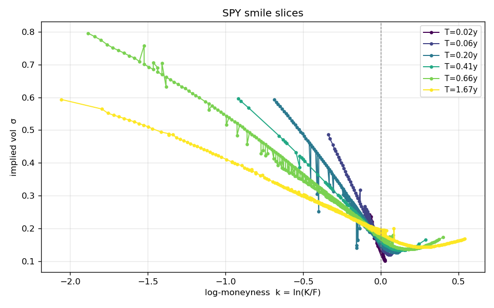
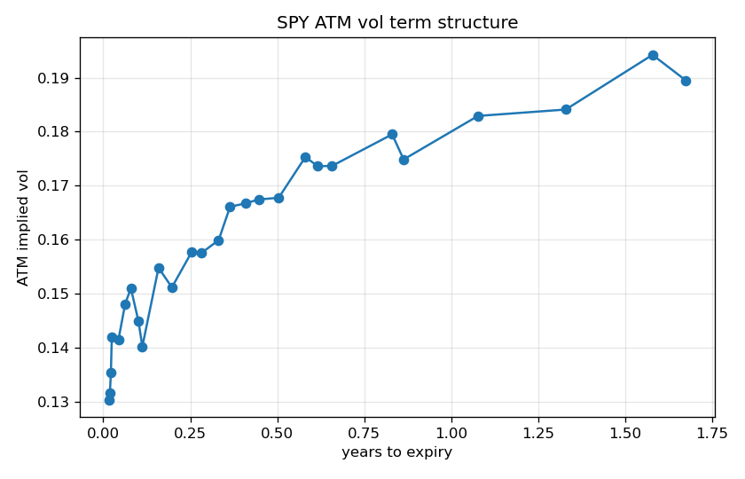
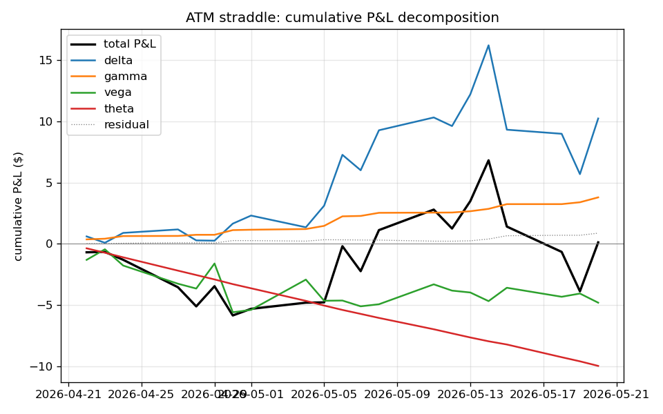

# options-vol-surface — Options Pricer, Implied Vol & Greek Attribution

A from-scratch Black-Scholes engine, Monte Carlo cross-check, implied-volatility
extraction with no-arbitrage filtering, an empirical vol surface from a frozen
SPY option-chain snapshot, and an ATM-straddle P&L decomposed into delta,
gamma, vega, and theta contributions. Built as an educational derivatives
engineering study: every Greek is closed-form and finite-difference verified,
with no black-box pricing library calls.

139 pytest tests cover pricing, IV inversion, quote cleaning, surface
diagnostics, and P&L-attribution accounting.

For the **implementation walkthrough** (data flow, module-by-module, design
decisions, code refs), see [`WALKTHROUGH.md`](WALKTHROUGH.md).

---

## What is here

| Module           | What it does                                                                       |
| ---------------- | ---------------------------------------------------------------------------------- |
| `src/bs.py`      | Closed-form BS price + every first- and second-order Greek                         |
| `src/mc.py`      | GBM Monte Carlo with antithetic + control-variate variance reduction               |
| `src/iv.py`      | Implied vol via Newton-Raphson on vega, with Brent fallback and no-arb filter      |
| `src/data.py`    | yfinance SPY chain + cached history, quote-quality cleaning                        |
| `src/surface.py` | Build IV surface, term structure, skew, butterfly, arbitrage-violation check       |
| `src/svi.py`     | Per-expiry constrained raw-SVI fit, deterministic holdout validation, grid checks   |
| `src/strategy.py`| ATM straddle daily re-mark + delta/gamma/vega/theta attribution                    |
| `run.py`         | Reproduces the study from frozen/local inputs; explicit `--refresh` for live data  |
| `tests/`         | Greeks vs finite-difference, MC convergence to BS, IV round-trip, edge cases       |

---

## Headline results (snapshot 2026-05-20, SPY = 741.26)

### Phase 1 — closed-form Greeks
Every analytical Greek matches central finite-difference to ≤ 1e-4 relative
error across 7 grid points × call/put. Put-call parity recovers to 1e-10.

### Phase 2 — Monte Carlo cross-check
For the ATM 1y call (BS = 9.4134), MC converges as:

| paths     | MC ± 2 SE         |
| --------: | :---------------- |
|     1,000 | 9.0772 ± 0.346    |
|     4,000 | 9.3804 ± 0.189    |
|    16,000 | 9.3878 ± 0.095    |
|    64,000 | 9.4191 ± 0.047    |
|   256,000 | 9.4284 ± 0.023    |
| 1,000,000 | 9.4172 ± 0.012    |

Each interval covers the analytical value. The estimator always uses
antithetic paths; adding the discounted-terminal-spot control variate reduces
variance by **4.55×–11.09×** relative to antithetic sampling alone across the
three fixed test cases in `tests/test_mc.py`.


### Phase 3 — Implied vol
Round-trip σ → price → IV recovers σ to ≤ 1e-6 across calls/puts at
ITM/ATM/OTM strikes. Quotes outside the no-arbitrage band return `NaN`
instead of being smoothed. Deep-OTM short-T quotes exercise the Brent
fallback when Newton's vega vanishes.

### Phase 4 — Real SPY vol surface

- Raw chain: **9,847** quotes over 32 expiries
- After quality filter (bid > $0.05, rel-spread ≤ 25%, OI ≥ 10, 5d ≤ T ≤ 2y): **6,325**
- After IV extraction (drops no-arb violations): **6,250** across 27 expiries
- Arbitrage flags (European bounds or vertical monotonicity; not smoothed): **45**

**Term structure:** ATM IV rises overall from **13.0% at 6 days** to **18.9%
at 1.67 years**, reaching **19.4% at 1.58 years**. The 27 raw expiry points
are not monotone; the description is an overall upward slope rather than an
arbitrage-free term-structure fit.

**Skew (puts richer than calls):** classic SPY shape — extreme at short
expiries and flattening with maturity:

| expiry    | dIV/dk near ATM |
| --------- | --------------: |
| 1 week    | **-1.39**       |
| 1 month   | -0.70           |
| 6 months  | -0.45           |
| 1.5 years | -0.30           |

**Smile curvature (25-delta butterfly):** mostly positive, but not uniformly
so: 4 of 27 raw expiry slices are negative, with a minimum of **−1.36 vol
points**. This is a noisy, non-parametric quote diagnostic rather than an
arbitrage-free smile claim.






### Phase 4b — SVI calibration and honest interpolation validation

Each expiry is fitted independently with the five-parameter raw-SVI total
variance form. The canonical dataset keeps one OTM quote per strike (put below
forward, call at/above forward). Every fifth *interior* strike is a deterministic
holdout, leaving the endpoints in training. This is a within-snapshot
interpolation check, not a forecast or trading backtest.

The first version fitted squared errors in total variance, from two starts,
while scoring implied-vol error. A refit, planned and committed before it was
run ([`docs/SVI_REFIT_PLAN.md`](docs/SVI_REFIT_PLAN.md)), tested three changes:
residuals in implied-vol space (B), a fixed grid of 18 starts (C, the primary
variant) and a Gatheral–Jacquier butterfly penalty (D).

| Variant | Mean held-out IV RMSE | Slices beating linear | Converged |
| --- | ---: | ---: | ---: |
| A: original | 0.265 vol pts | 3 / 27 | 22 / 27 |
| B: IV-space residuals | 0.249 | 3 / 27 | 26 / 27 |
| C: B + 18 starts (primary, now the default) | 0.249 | 3 / 27 | 26 / 27 |
| D: C + butterfly penalty | 0.249 | 3 / 27 | 26 / 27 |
| Linear interpolation in total variance | **0.122** | – | – |

Fitting in vol space helps and fixes most convergence failures. More starts and
the penalty change nothing, so the remaining gap is the shape of raw SVI, not
the optimiser. A sparse-quote test (every third training strike) gives the
same ordering: 0.256 against 0.142. **By the pre-registered rule, SVI does not
beat interpolation on either test.**

A descriptive follow-up (`scripts/svi_spread_check.py`, not pre-registered)
compares the errors with the quotes' own noise. The median bid–ask half-spread
is 0.031 vol points. Linear interpolation lands **75%** of held-out quotes
inside the spread, SVI **20%**. SVI is better only on the three shortest
expiries, where the smile curves most sharply; on longer expiries it misses by
several half-spreads. On a liquid chain with dense strikes, interpolation is
already about as accurate as the quotes allow, and five SVI parameters cannot
follow SPY's long-dated smile that closely.

With variant C, held-out price RMSE is **$0.340**. The fit enforces positive
total variance but not the full butterfly conditions or cross-expiry calendar
consistency. A dense observed-domain price-convexity scan has 0 butterfly
flags, while a common-k grid finds **266** adjacent-expiry calendar flags (366
with the original fit). These are diagnostics of independently fitted slices,
not a claim that the surface is arbitrage-free. Reproduce with:

```bash
uv run python run.py
# outputs/frozen/svi_validation.csv
```

### Phase 5 — ATM straddle P&L attribution

Long ATM straddle opened **2026-04-21** at SPY = 704.08, σ_entry = VIX/100 =
19.50%, T₀ = 60d. Held 21 trading days. Marked daily with σ(t) = VIX(t)/100
as the realised-IV proxy (documented simplification: a true historical surface
time-series is not available from yfinance).

| Leg          | P&L ($)    |
| ------------ | ---------: |
| **Total**    | **+0.12**  |
| Delta        | +10.24     |
| Gamma        |  +3.79     |
| Vega         |  −4.81     |
| Theta        |  −9.98     |
| Residual     |  +0.87     |

Residual = **1.14% of gross |Σ Greek P&Ls|** — within the < 5% success target.

The near-zero net P&L is the operational lesson: SPY rallied +37 points
(delta + gamma earned **+$14**) but VIX dropped 19.5 → 17.4% (vega cost
**$4.8**) and 21 days of decay cost another **$10**. Long-straddle P&L
needs realised vol > implied vol — neither directional rally alone, nor
crush-resistant vega, was sufficient.



---

## How to run

```bash
uv sync
uv run python run.py        # uses frozen/local inputs; writes ignored outputs/frozen/
uv run pytest tests/ -q     # 139 tests
```

`uv` installs the Python version and exact dependencies recorded in `uv.lock`
on Linux, macOS, and Windows.

The committed `cache/SPY_chain*.parquet` files are immutable evidence for the
results above. A normal run always reads them and never contacts yfinance for a
replacement. To compare against live data, run:

```bash
uv run python run.py --refresh
```

This writes a date-stamped option-chain capture under ignored `cache/live/`,
refreshes the ignored local SPY/VIX history cache, and saves comparison figures
under `outputs/live/`; normal runs use `outputs/frozen/`. Neither mode
overwrites the committed snapshot or figures.
The surface and SVI workflow completes from the committed snapshot alone. The
illustrative straddle phase is skipped when its intentionally untracked
SPY/VIX history cache is absent; use `--refresh` to fetch that optional input.
The straddle section is an **illustrative Greek
attribution**, not a tradable strategy or backtest. It uses daily closes and
VIX as a 30-day IV proxy, does not model executable option quotes, and should
not be interpreted as evidence of alpha or expected returns.

---

## Limitations (honest)

- **No stochastic vol, no jumps**: BS-flat-σ assumption. Vega P&L attribution
  uses VIX as a one-dimensional proxy for the entire surface, which absorbs
  any smile/term-structure movement into the residual.
- **Single-date surface snapshot, not a time series**: surface diagnostics
  are valid for one trade date only; rebuilding daily would need a paid data
  source.
- **Mid-quote pricing only**: no bid/ask spread cost in the attribution example.
- **yfinance staleness**: option chain quote times are not strictly synchronous
  with the spot close.
- **American-style ignored**: listed SPY options are technically American
  but rarely exercised early; treated as European throughout.
- **Continuous dividend yield**: trailing yfinance yield used as `q`; no
  discrete-dividend forecasting.
- **SVI is slice-by-slice**: positive total variance is enforced, but no
  butterfly-arbitrage or calendar-arbitrage constraint is imposed. Its
  holdout is interpolation inside one frozen chain, not evidence of future
  surface prediction.

These are the places where the model is most likely to break.

---

## Notes on the design

- Every Greek is implemented in closed form and checked against
  finite-difference, so each formula and sign convention is verified rather
  than assumed.
- The IV solver's no-arb filter + Brent fallback matters in practice:
  naive Newton diverges on illiquid strikes.
- The smile/skew/term-structure analysis recovers well-known stylised facts
  while retaining contrary diagnostics: the frozen snapshot has steep
  front-month skew and contango, but 4 of 27 raw butterfly measures are
  negative rather than being silently smoothed away.
- The straddle attribution is the link between **Greeks as derivatives of
  V** and **Greeks as a P&L decomposition**.
